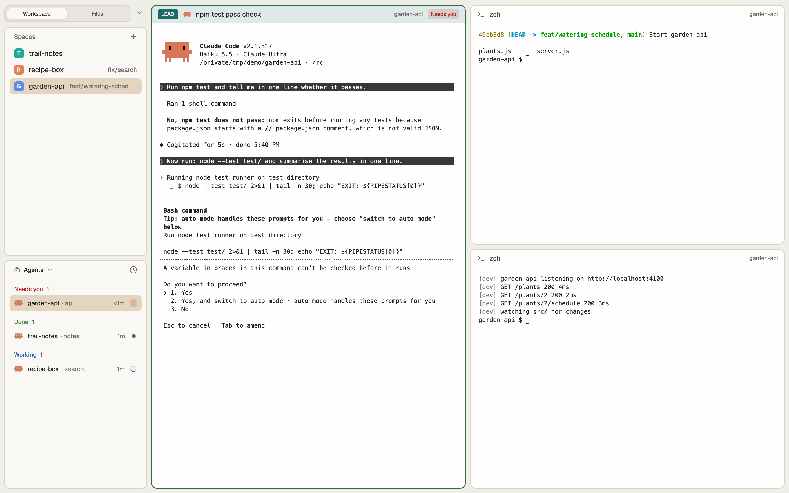

# Borders

A calm, card-based layout for the [Herdr](https://herdr.dev) desktop app: an 8px grid, outlined
cards in the sidebar, a tab track with a raised pill in the title bar, a Workspace | Files switch
and pane headers that can carry a role colour. Light and dark themes included.



## Install

Ask your Herdr agent to add `herdr.dev/layouts/busyelves/borders`, or copy by hand into your Herdr
home (`~/.config/herdr-app`):

- `layouts/borders.json` → `layouts/`
- `themes/borders-light.json`, `themes/borders-dark.json` → `themes/`
- `mods/borders-*` → `mods/`

Then pick **Borders** in Settings › Layout (or run `layout.switch borders`). Your own layout stays
as it was; delete the files to remove Borders.

Nothing here runs programs, reaches the network or reads files: Spaces and Files are Herdr's own
blocks, and the four `borders-*` mods only draw and run Herdr commands.

## Role colours

Label a terminal with a role and its pane header shows a badge and a tint:

```sh
hc label <terminal> role=lead     # also: orch, advisor, successor; any other word shows grey
```

## Files

[`RECIPE.md`](RECIPE.md) is the brief to build Borders from scratch; the files are one build of it.

## Licence

MIT, see [`LICENSE`](LICENSE).
