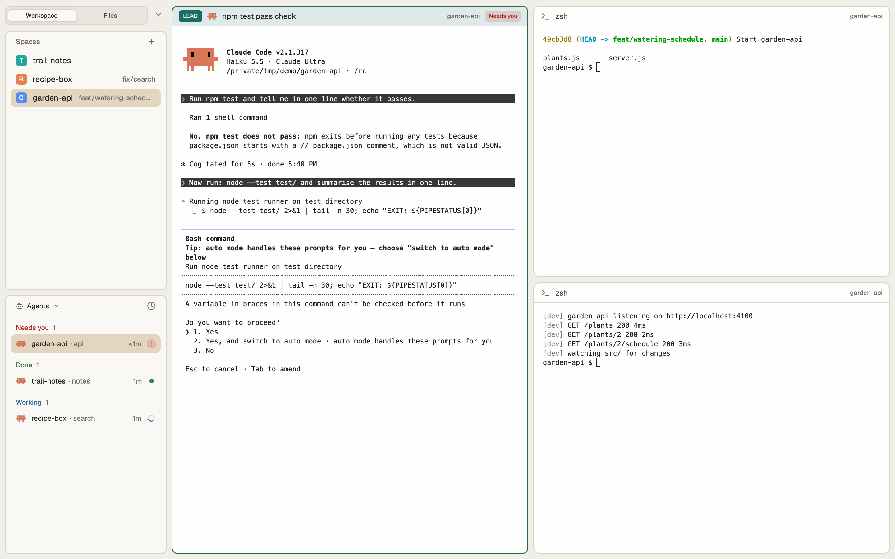

# Borders

A quiet, card-based window: on the left a sidebar of outlined cards (Spaces and Agents, or the
file tree) under a Workspace | Files switch; on the right one rounded work card whose title bar
holds the space's tabs in a track with a raised pill, above framed panes whose headers name what
runs in them and can carry a role colour. Everything sits on an 8px grid, in warm greys with a
forest-green focus ring, light and dark.

## What you see

Left to right, top to bottom:

1. **Sidebar, 268px wide** (min 44, max 480), on the window's `backdrop` (light `#f0eee9`, dark
   `#3b3a39`), 4px window padding left and right.
   - **Switch row, 42px** (drags the window). A 30px track (`hover` fill, 1.5px `card_border`
     outline, radius 8, 3px inset) holding *Workspace* and *Files* at 10px; a pill half the track
     wide (`sidebar_card` fill, 1px `card_border`, radius 6, extra-small shadow) sits under the
     shown one, its label `foreground` and medium weight, the other `muted`. 10px above, 4px
     either side.
   - **Body**, a stack of two views, padding 8px top and bottom, 4px sides:
     - *Workspace*: two cards 8px apart, each `sidebar_card` (light `#f9f8f5`, dark `#444342`),
       1.5px `card_border` outline (light `#d8d2c7`, dark `#595755`), radius 8, sharing the height
       evenly with a draggable divider between them:
       - **Spaces**: Herdr's Spaces block, restyled: a 31px header (12px layers icon, "Spaces"
         11px bold `foreground`, a fold chevron; a + on the right), then each machine's spaces
         with branch and status.
       - **Agents**: a 32px header (12px agent icon, "Agents" 11px bold `foreground`, a fold
         chevron 11px `dim`; a sort button on the right), then Herdr's agent rows, 11.5px.
     - *Files*: one card, the same style, filling the body: Herdr's Files tree for the focused
       pane's folder, without its own frame.
2. **Work card**, the rest of the width, 6.5px from the top and bottom and 2.5px from the sides:
   `canvas` fill, 1.5px `workspace_border` outline (invisible in light, `#595755` in dark),
   radius 10.
   - **Title bar, 42px** (drags the window; 2px top, 10px bottom padding). Empty on the left;
     on the right the active space's tabs in a track (`hover` fill, 1.5px `card_border`, radius 8,
     3px inset, 2px between tabs), at most 85% of the bar wide, then a 26px **+** and a 26px **^**.
     Each tab: 10px text, the program's 14px icon, the name (the program's name for an unnamed
     tab, cut at 170px), radius 6, 10px sides. The active tab is the raised pill: `sidebar_card`
     fill, 1px `card_border`, extra-small shadow, medium weight, `foreground`, with a 12px close
     ×; the others `muted`, no fill.
   - **Panes**, each framed: `background` fill (light `#fffefe`, dark `#464544`), 1.5px `border`
     outline, radius 10, 8px between panes, the outline `focus_border` (light `#2E6B3F`, dark
     `#4E9A62`) on the focused pane. Terminal text 14px from the sides and 12px from the top and
     bottom. A lone pane is framed too.
   - **Pane header, 32px**, always shown: 10px sides, 8px gaps, a 1px `border` line under it,
     rounded with the pane (8.5px top corners). Left: the role badge if any (19px tall, radius 5,
     the role colour, the role in white 9.5px bold capitals), the program's 16px icon, the name
     12.5px semibold (`foreground` when focused, else `muted`, cut at 320px). Right: the folder's
     last part (`~` for home) in `dim` 10.5px, then the status.
   - A **side panel** (Files or Changes, 368px, min 280, max 900) can open right of the panes,
     5px away; hidden at first. A **status bar** (28px) is in the layout but hidden.
3. **Themes**: `borders-light` and `borders-dark`, picked by the system appearance; and
   `borders-parchment`, picked in Settings › Theme: backdrop and bars `#424242`, cards `#4b4b4b`
   with a `#3a3a3a` edge, light text on them (`#e6e6e6`, `#c9c9c9`, `#a3a3a3`), the selected row
   gold `#85764F`; panes cream `#e9e1d9` with `#2b2622` text, focus `#BC5215`, accent `#b89251`.
   The other two: Muted
   `#49453e` / `#c9c4b9`, dim `#706b60` / `#9a958b`, selected `#e3d5bf` / `#615a4e`. Role
   colours (Flexoki 600 in light, 400 in dark): lead `#1C6C66` / `#3AA99F`, orch `#205EA6` /
   `#4385BE`, advisor `#5E409D` / `#8B7EC8`, successor `#BC5215` / `#DA702C`.

## How it behaves

- **Agent status** shows in three places, the same colours everywhere (`working` `#286ba6` /
  `#6ca0dc`, `blocked` `#b3261e` / `#f07a62`, `done` `#427b49` / `#6cc08b`, `idle` `#706b60` /
  `#9a958b`):
  - *Tab*: working, a still 8px dot; blocked or done, a 6px dot; idle, nothing.
  - *Pane header*: working, a still 8px dot; blocked, a "Needs you" pill (`blocked` text on a
    15% `blocked` fill); done, a 7px dot; idle, nothing.
  - *Agents card*: Herdr's own rows and grouping (blocked first when sorted by priority).
  - No spinners anywhere: a turning glyph would redraw the window every frame.
- **Switch**: click a label, or swipe two fingers sideways over the switch or the Agents card
  (left for Files, right for Workspace, back and forth while the fingers stay down); the pill
  slides in 180ms, ease-out. Commands `borders-switch.toggle`, `.workspace`, `.files` (no keys
  bound).
- **Folding**: a click on the Agents header (or its chevron) folds the card to its 32px header
  and the chevron turns right; Spaces takes the room. Clicking again restores the height it had;
  dragging the divider down also unfolds it.
- **Tabs**: click selects; press one and release on another to move it there; double-click
  renames; right-click opens the tab menu; the wheel over the track steps to the previous or next
  tab. The × on the active tab closes it. **+** opens the new menu.
- **Title bar**: **^** shrinks it to 1px; a down arrow then appears right of the switch and
  brings it back to 42px. With the sidebar hidden, the bar leaves room for the window buttons
  when they are shown.
- **Pane header**: hovering shows split right, split down, zoom (unzoom when zoomed) and close;
  a click anywhere else on it focuses the pane. A terminal labelled `role=<name>` gets the badge
  and a 8% tint of its role colour (14% when focused); lead, orch, advisor and successor have
  colours, any other name is `dim`.
- **Side panel**: remembered per space; switching spaces shows that space's last choice.

## Built from

- **Layout** `layouts/borders.json`, root a `row` on `backdrop`, `titlebar: "none"`,
  `traffic_lights: [-200, -200]`, `terminal_padding: [14, 12]`, `terminal_opacity: 0`, theme
  `{ light: "borders-light", dark: "borders-dark" }`:
  - `sidebar` column (268px, not resizable): `sidebar-switch` block (42px, `window_drag`,
    mod `borders-switch`) → `sidebar-body` stack (active `sidebar-lists`):
    - `sidebar-lists` column (resizable, gap 8, padding [8, 4]): block `spaces` (mod
      `borders-spaces`, weight 1, min 31) and block `agents` (mod `borders-agents`, weight 1, min 35),
      each a card (`sidebar_card`, 1.5px `card_border`, radius 8).
    - `sidebar-files` column (padding [8, 4]): one card block, mod `borders-files`.
    - then `sidebar-footer` (shipped `workspace-chrome` footer, hidden).
  - `work` column (padding [6.5, 2.5]) → `work-card` column (`canvas`, 1.5px `workspace_border`,
    radius 10): `borders-top` block (42px, `window_drag`, mod `borders-top`) → `work-body` row
    (gap 5): `main` block `{ tab: "active", pane: { header: { content: { mod: "borders-pane" },
    reveal: "always", height: 32, position: "top" }, background, border 1.5 `border`, focus 1.5
    `focus_border`, radius 10, gap 8, lone: true } }` and `panel` column (368px, hidden) →
    `panel-body` stack of shipped `files` and `changes` → `status` block (shipped
    `workspace-status`, 28px, hidden).
- **Mods** (all `place: "none"`; none reaches the network). Each sidebar and bar mod passes
  `theme()` through `side.js`, which swaps in a theme's `chrome_*` colours (Parchment's light text
  on grey) and leaves themes without them as they are:
  - `borders-switch`: the switch; `swipe.js`. Reads `layout()`; runs `layout.select` on stack
    `sidebar-body`, `layout.resize` on `borders-top`.
  - `borders-top`: the title bar. Reads `spaces()`, `panes()`, `layout()`, `window()`,
    `settings()`, `shared("workspace.panels")`; runs `tab.select`, `tab.move`, `tab.rename`,
    `tab.close`, `tab.prev`, `tab.next`, `layout.select`/`layout.show`/`layout.hide` on the
    panel, `layout.resize`; opens shipped `menu` and `new-menu` popups. Icons `close.svg`,
    `chevron-up.svg`. Keeps the per-space panel choice in `localStorage`.
  - `borders-pane`: the pane header (a copy of shipped `pane`, restyled, with role badges).
    Reads `panes()`, `terminals()` (labels), `home()`, `props()`; runs `pane.focus`,
    `pane.split`, `pane.zoom`, `pane.close`. Icons `split-right`, `split-down`, `zoom`,
    `unzoom`, `close`.
  - `borders-agents`: shipped `agents` (0.1.12) with its own background and top line removed
    (the card draws them), a 32px header that folds, the swipe, and its sort popup pointed at
    itself. `fold.js` keeps the unfolded size in shared `borders.folds`.
  - `borders-spaces`: shipped `spaces` (0.1.12) without its `chrome` fill, with a folding header,
    the swipe and `side.js`. Runs what the shipped block runs: `git status` / `rev-parse` in each
    space's folder, `hc machine ls` and `hc` lookups for other machines.
  - `borders-files`: shipped `files` (0.1.12) without its own frame (the card draws it), with
    the swipe and `side.js`. Runs `sh` to list a folder and `git status` for change marks; reads
    the file it shows.
- **Shipped mods used**: `files` and `changes` (the side panel), `menu`, `new-menu`, `workspace-chrome`,
  `workspace-status`; icons `mods/workspace-chrome/chevron-*.svg`, `mods/files/chevron-down.svg`,
  `icons/agent.svg`.
- **Themes**: `themes/borders-light.json`, `themes/borders-dark.json`,
  `themes/borders-parchment.json` (with `chrome_foreground`, `chrome_muted`, `chrome_dim`,
  `chrome_hover`, `chrome_raised`, `chrome_selected`, `chrome_border`, `chrome_input` for the bars).
  Besides Herdr's colours
  they define `backdrop` (behind the cards), `sidebar_card`, `card_border`, `workspace_border`,
  `focus_border` and `role_lead`, `role_orch`, `role_advisor`, `role_successor`. `chrome` is set
  to the card colour in light and dark.
- No art beyond the icons, no keys.

## Watch out

- Herdr's shipped blocks paint `chrome` as their background and read the theme's own text
  colours; that is why Spaces, Agents and Files are copies here. A layout node's `theme` only
  recolours what the layout draws (fills, borders), not the text inside a mod: dark bars with light
  text need `side.js` in every mod on them.
- The shipped Agents block also draws a 1px line along its top; inside a card it doubles the
  card's edge, so `borders-agents` drops it.
- Popups the bar mods open (menus, the sort menu) sit on `popover` and keep the theme's own
  colours: `side.js` returns the theme untouched when `props().overlay` is set.
- A fold is read from the block's height (no taller than its header plus 3px of border), not a
  flag, so a dragged divider unfolds it; the block's `min` must stay at or below 35.
- The title bar hides to 1px, never `layout.hide` or 0: hidden mods get no live data and no
  commands, so it could not come back.
- Mods cannot import across folders: `swipe.js` is copied into each mod that uses it, and the
  swipe runs `borders-switch.files` / `.workspace`, so the switch mod must keep that name.
- The window buttons are moved off-screen (`traffic_lights: [-200, -200]`): close and minimise
  with the keyboard. Put them back with e.g. `[14, 20]` and pad the switch row to suit.
- Renaming any mod means renaming its `mods/<name>/` icon paths and the overlay `mod` names
  (`borders-agents` opens itself as its sort popup).
- Tested on Herdr 0.1.12, macOS.

## Done when

- `herdr-app check mods/<name>` passes for each of the four `borders-*` mods.
- `layout.switch borders` shows the layout with an empty error list in `herdr-app status`.
- The switch flips Workspace and Files by click, and by a two-finger swipe over the Agents card.
- The Agents header folds the card to 32px + border and back.
- The active tab is a raised pill; dragging a tab onto another moves it; ^ hides the bar and
  the arrow by the switch brings it back.
- `hc label <terminal> role=lead` gives that pane a teal LEAD badge and tint; removing the label
  removes them.
- The focused pane's outline is forest green; a blocked agent's header shows "Needs you".
